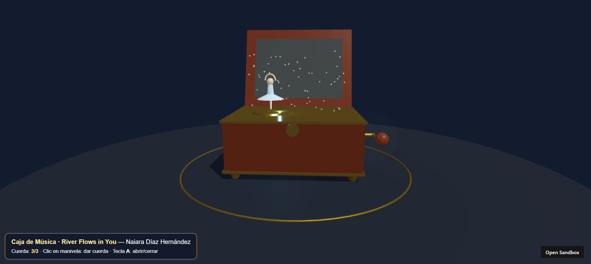
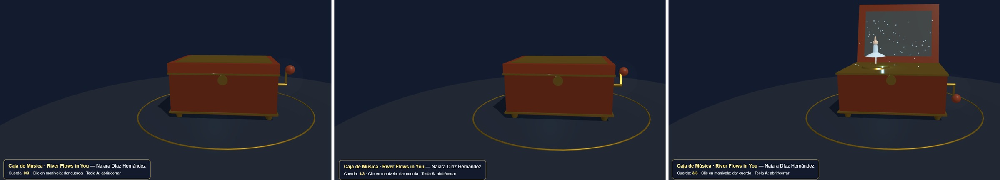

# Caja de música — Three.js y Tween.js

Caja de música en 3D con una bailarina que sale al abrir la tapa y gira mientras suena *River Flows in You*. Hay que darle cuerda con el ratón en una manivela lateral y abrirla con una tecla. Está hecha con Three.js y Tween.js.

Práctica de la semana 11 de Informática Gráfica. Naiara Díaz Hernández, Universidad de Las Palmas de Gran Canaria.

  
*Caja abierta con la bailarina girando*

Vídeo:

- **Demo de la caja de música (1920×1080, < 60 s):**   
  - YouTube: [Enlace al vídeo de la demo](https://youtu.be/KmmzgZ3Vkwc)

---

## Índice

1. [Idea](#idea)
2. [Controles](#controles)
3. [Desarrollo técnico](#desarrollo-técnico)
   - [1. Escena, luces y mesa](#1-escena-luces-y-mesa)
   - [2. Pivotes y jerarquía](#2-pivotes-y-jerarquía)
   - [3. Qué va con Tween.js y qué va en el bucle](#3-qué-va-con-tweenjs-y-qué-va-en-el-bucle)
   - [4. Clic en la manivela con Raycaster](#4-clic-en-la-manivela-con-raycaster)
   - [5. Audio](#5-audio)
   - [6. Estados](#6-estados)
4. [Limitaciones](#limitaciones)
5. [Cómo ejecutarlo](#cómo-ejecutarlo)
6. [Referencias y uso de IA](#referencias-y-uso-de-ia)

---

## Idea

Para la práctica de animación no quería mover un objeto suelto de un lado a otro, sino algo con varias piezas que dependieran unas de otras. Una caja de música de bailarina encajaba bien, porque ya trae una secuencia: se da cuerda, se abre la tapa y entonces empieza a sonar y a moverse todo.

Funciona así:

1. Se hace clic en la manivela. Cada clic es una vuelta completa con un chasquido, y hacen falta tres.
2. Con la tecla `A` se abre la tapa, que se levanta desde la bisagra de atrás, y después sube el pedestal con la bailarina.
3. Cuando la caja está abierta y la cuerda está en `3/3`, empieza la música, aparecen unas partículas y la bailarina gira y da saltitos mientras la manivela se va desenrollando sola.
4. Al volver a pulsar `A`, o cuando acaba la canción, baja la bailarina y se cierra la tapa.

El orden en que se hagan las dos primeras cosas da igual. Si abres la caja primero, la música arranca en cuanto das la tercera vuelta. Si das cuerda primero, arranca al terminar de abrirse.

  
*Caja cerrada, dando cuerda y mecanismo en marcha*

[Volver al índice](#índice)

---

## Controles

| Acción | Control |
|---|---|
| Dar cuerda | Clic en la manivela (de `0/3` a `3/3`) |
| Abrir y cerrar | Tecla `A` |
| Mover la cámara | Arrastrar y rueda del ratón (`OrbitControls`) |

Abajo a la izquierda hay un pequeño cuadro con el título de la canción, la cuerda que lleva (`0/3`) y un recordatorio de los controles.

[Volver al índice](#índice)

---

## Desarrollo técnico

El código está en un solo archivo, `caja_de_musica.js`, dividido en funciones pequeñas: una para la escena, otra para las luces, el audio, cada parte de la caja, la lógica y los eventos.

### 1. Escena, luces y mesa

El fondo es un azul oscuro (`0x131b2e`) para que la madera y el dorado destaquen. La cámara apunta al centro de la caja (`0, 1.4, 0`) y no al suelo, porque si no al orbitar todo se descentraba.

Uso tres luces:
- `AmbientLight`, para que las caras en sombra de la madera no se queden negras.
- `DirectionalLight` cálida, que hace de luz principal y echa las sombras sobre la mesa.
- `PointLight` azul clara (`0x7dd3fc`) colocada encima de la bailarina, para que al abrir la tapa el interior coja algo de luz.

La mesa es un cilindro grande con un aro dorado (`TorusGeometry`) que subí `0.01` sobre el suelo para que no parpadeara con la superficie de la mesa (*z-fighting*).

### 2. Pivotes y jerarquía

En Three.js una malla gira sobre su propio centro, así que para que la tapa se abriera como una bisagra y no girando sobre sí misma, usé `Object3D` vacíos como pivotes dentro de un grupo general (`cajaGrupo`):

- `pivoteTapa` está en el borde de arriba de la parte trasera. La tapa, el marco dorado y el espejo cuelgan de él, desplazados hacia delante. Rotando `pivoteTapa.rotation.x` se abre bien.
- `pivoteManivela` está en el lateral derecho y agrupa el eje, el brazo y el pomo para que giren juntos.
- `pivotePedestal` sube y rota sobre `Y`, y arrastra a `figura`, la bailarina, que solo mueve su altura para los saltos. Esa separación me permitió girar y saltar a la vez sin que se molestaran entre ellos.

```js
pivoteTapa = new THREE.Object3D();
pivoteTapa.position.set(0, alto, -fondo / 2);
padre.add(pivoteTapa);

const tapa = new THREE.Mesh(new THREE.BoxGeometry(ancho + 0.06, 0.45, fondo + 0.06), matMadera);
tapa.position.set(0, 0.225, fondo / 2);
pivoteTapa.add(tapa);
```

La bailarina está hecha solo con primitivas: un cilindro fino de pierna, un cono para el tutú, otro cilindro de torso, una esfera de cabeza y medio toroide de brazos.

### 3. Qué va con Tween.js y qué va en el bucle

Me puse una regla para decidirlo. Lo que tiene principio, fin y duración va con `TWEEN.Tween`, y lo que se repite sin parar mientras suena la música va en el bucle de animación. Los tweens están en un `TWEEN.Group` propio, que se actualiza en cada fotograma con `tweenGroup.update()`.

| Animación | Duración y curva | Detalle |
|---|---|---|
| Vuelta de manivela | 450 ms, `Quadratic.Out` | Al acabar suma 1 a la cuerda |
| Apertura de la tapa | 1400 ms, `Back.Out` | Encadenada a la subida del pedestal |
| Subida del pedestal | 1100 ms, `Exponential.InOut` | Al acabar arranca la música si la cuerda está al máximo |
| Salto de la bailarina | 750 ms, `Sinusoidal.InOut` | Dos tweens encadenados entre sí, en bucle |
| Partículas | 1200 ms, lineal | La opacidad pasa de `0` a `0.85` |
| Cierre | 900 ms + 1100 ms | Primero baja el pedestal y luego se cierra la tapa |

En el bucle (`actualizarElementosEnMarcha()`), mientras `enMarcha` es `true`, el pedestal rota, la manivela se desenrolla un poco en cada fotograma y las partículas suben.

La apertura es lo que más me gustó de encadenar, porque la tapa tiene que acabar de abrirse antes de que salga la bailarina:

```js
tweenTapa.chain(tweenSubir);
tweenTapa.start();
```

El salto de la bailarina lo hice con dos tweens que se encadenan el uno al otro (`tweenArriba.chain(tweenAbajo)` y al revés), que es una forma sencilla de hacer un bucle infinito.

### 4. Clic en la manivela con Raycaster

Para poder dar cuerda pinchando directamente en la manivela uso un `THREE.Raycaster` contra `pivoteManivela`, con búsqueda en sus hijos. Al probarlo me di cuenta de dos cosas:

- El eje y el brazo son tan finos que era difícil acertar. Puse alrededor una esfera casi invisible (`zonaClic`, con `opacity: 0.01` y `depthWrite: false`) para que el área donde se puede pinchar sea mayor.
- Si empezaba a arrastrar la cámara con el ratón encima de la manivela, al soltar contaba como clic. Lo resolví guardando la posición en `pointerdown` y, en `pointerup`, solo dando cuerda si el ratón se ha movido menos de `10 px`.

También cambio el cursor a `pointer` cuando pasa sobre la manivela y a `grab` en el resto, para que se note qué es clicable.

### 5. Audio

Hay dos sonidos. La melodía es un MP3 cargado con `THREE.AudioLoader` en un `THREE.Audio`. El chasquido de la cuerda no lo cargué de ningún archivo, lo genero con Web Audio API: `reproducirSonidoCuerda()` lanza cuatro pulsos cortos (`0.04 s`) con osciladores de onda triangular, cada uno con una frecuencia algo más alta que el anterior, y suena bastante a carraca de muelle.

Como el navegador no deja reproducir sonido hasta que el usuario hace algo en la página, `darCuerda()` y `abrirCaja()` comprueban si el contexto está en `suspended` y lo reanudan antes de nada.

Cuando termina la canción, `sound.onEnded` pone la cuerda a `0` y cierra la caja. Aquí hay un detalle que me dio guerra. Al cerrar con `A` también paro el audio con `sound.stop()`, lo cual dispara `onEnded`, y no quería que eso volviera a cerrar la caja. Para evitarlo, `alTerminarMelodia()` sale sin hacer nada si `enMarcha` ya es `false`, y `cerrarCaja()` lo pone a `false` antes de parar el sonido.

### 6. Estados

Para que no se pisen las animaciones si se pulsa rápido, todo depende de cuatro variables:

- `nivelCuerda`, de `0` a `3`.
- `dandoCuerda`, que bloquea otro clic mientras dura la vuelta de 450 ms.
- `abierta`, si la tapa está levantada.
- `enMarcha`, que solo pasa a `true` si la caja está abierta y la cuerda está a `3`.

Al cerrar llamo a `tweenGroup.removeAll()`, porque si no el bucle de saltos de la bailarina seguiría vivo y se mezclaría con la animación de bajada.

[Volver al índice](#índice)

---

## Limitaciones

- La bailarina es una figura muy simple, hecha con primitivas. Con un modelo `.glb` quedaría mucho mejor, pero preferí montarla yo.
- El audio no suena hasta la primera interacción con la página, por la política de los navegadores.
- Las partículas (`THREE.Points`) suben en línea recta y vuelven a `y = 2.0` al pasar de `4.5`. No hay viento ni nada que se parezca a física.
- El cilindro con púas y el peine del mecanismo están modelados, pero casi no se ven, porque la atención se la lleva la bailarina.

[Volver al índice](#índice)

---

## Cómo ejecutarlo

### En CodeSandbox

Se puede ver directamente en el navegador:
- **Sandbox:** [Enlace a CodeSandbox](https://codesandbox.io/p/sandbox/practica-s11-clwp6l)

### En local (Node.js)

Clonar o descargar el repositorio y, en la raíz:

```bash
npm install
npm run dev
```

El servidor suele arrancar en [http://localhost:5173/](http://localhost:5173/).

El MP3 tiene que estar en `src/` con el nombre `25_river-flows-in-you_musicboxmaniacs.com.mp3`, que es como se llama en `configurarAudio()`.

[Volver al índice](#índice)

---

## Referencias

- [Guion de la semana 11 de Informática Gráfica](https://github.com/otsedom/otsedom.github.io/tree/main/IG/S11): animación con Tween.js, jerarquías, Raycaster y audio en Three.js.
- [Documentación de Three.js](https://threejs.org/docs/): `Object3D`, `Raycaster`, `Audio`, `AudioLoader` y `Points`.
- [Documentación de Tween.js](https://github.com/tweenjs/tween.js): `Group`, `Easing` y `.chain()`.
- Audio: *River Flows in You* (versión caja de música), de [MusicBoxManiacs](https://musicboxmaniacs.com/).

***
Grado en Ingeniería Informática  
Naiara Díaz Hernández — Informática Gráfica
