# Canarias de noche

Visualización 3D en three.js de la luz artificial nocturna de Canarias sobre el relieve del archipiélago, con los observatorios del Teide y del Roque de los Muchachos marcados con conos de luz hacia el cielo.

Práctica de la semana 8 de Informática Gráfica. Naiara Díaz Hernández, Universidad de Las Palmas de Gran Canaria.

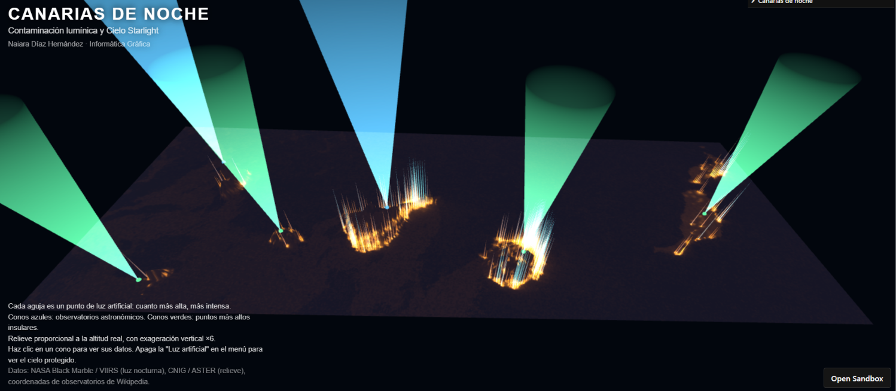  
*Vista general de la escena*

Vídeo de la demo: [enlace al vídeo](https://youtu.be/Ffc4vgXZPIk)

## Índice

1. [La idea](#la-idea)
2. [Qué se ve](#qué-se-ve)
3. [Datos](#datos)
4. [Preparación de las imágenes](#preparación-de-las-imágenes)
5. [Construcción de la escena](#construcción-de-la-escena)
   - [Terreno](#terreno)
   - [Luces de las ciudades](#luces-de-las-ciudades)
   - [Agujas de luz](#agujas-de-luz)
   - [Observatorios y cumbres desde un CSV](#observatorios-y-cumbres-desde-un-csv)
   - [Estrellas](#estrellas)
6. [Interacción](#interacción)
7. [Limitaciones](#limitaciones)
8. [Cómo ejecutarlo](#cómo-ejecutarlo)
9. [Referencias](#referencias)

## La idea

Canarias tiene dos de los observatorios más limpios del mundo, el del Teide y el del Roque de los Muchachos, protegidos por la Ley del Cielo. A la vez, las ciudades y las zonas turísticas emiten mucha luz hacia arriba.

La visualización pone las dos cosas en la misma imagen. Cada punto de luz artificial se convierte en una aguja que crece sobre el mapa, y los observatorios apuntan al cielo con un cono. Con una casilla del menú se apaga la luz artificial para ver cómo sería el cielo sin ella.

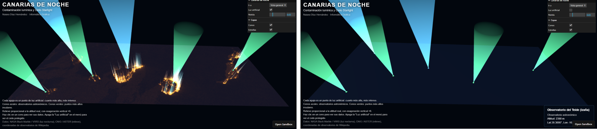  
*Izquierda: luz artificial encendida. Derecha: cielo protegido*

[Volver al índice](#índice)

## Qué se ve

| Elemento | Qué representa | De dónde sale |
|---|---|---|
| Terreno | Relieve de las islas | Mapa de altura |
| Brillo naranja | Luz artificial de ciudades y carreteras | Imagen VIIRS |
| Agujas | Puntos de luz. Más altas cuanto más intensos | Imagen VIIRS |
| Conos azules | Observatorios astronómicos | `cielo.csv` |
| Conos verdes | Punto más alto de otras islas | `cielo.csv` |
| Puntos blancos | Estrellas | Generadas por código |

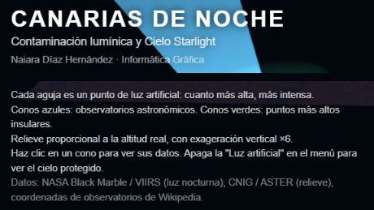  
*Título y leyenda dentro de la propia escena*

[Volver al índice](#índice)

## Datos

- **Luz nocturna:** NASA Worldview, capa de luces nocturnas VIIRS (NASA Black Marble). Captura del 10 de julio de 2021 (`snapshot-2021-07-10.jpg`).
- **Relieve:** Tangram Heightmapper, que usa modelos digitales de elevación globales (SRTM y ASTER). Recortado y alineado a mano con la imagen de luz.
- **Fondo de estrellas:** textura de la Vía Láctea de Solar System Scope.
- **Observatorios:** coordenadas y altitudes de Wikipedia: [Teide](https://en.wikipedia.org/wiki/Teide_Observatory) y [Roque de los Muchachos](https://en.wikipedia.org/wiki/Roque_de_los_Muchachos_Observatory).
- **Cumbres:** altitud del punto más alto de cada isla. Las coordenadas son aproximadas.

El CSV con los puntos es [`src/cielo.csv`](src/cielo.csv):

```
nombre;tipo;latitud;longitud;altitud_m
Observatorio del Roque de los Muchachos;observatorio;28.7636;-17.8947;2396
Observatorio del Teide (Izaña);observatorio;28.3000;-16.5097;2390
Pico de las Nieves (Gran Canaria);cumbre;27.96;-15.57;1949
Garajonay (La Gomera);cumbre;28.12;-17.24;1487
Malpaso (El Hierro);cumbre;27.76;-17.97;1501
Morro Velosa (Fuerteventura);cumbre;28.44;-14.05;669
```

[Volver al índice](#índice)

## Preparación de las imágenes

Hacen falta dos imágenes en tonos de gris, del mismo tamaño (1055 x 385 píxeles) y de la misma zona.

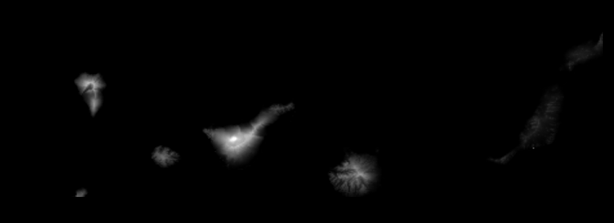  
*Mapa de altura (`relieve.png`)*

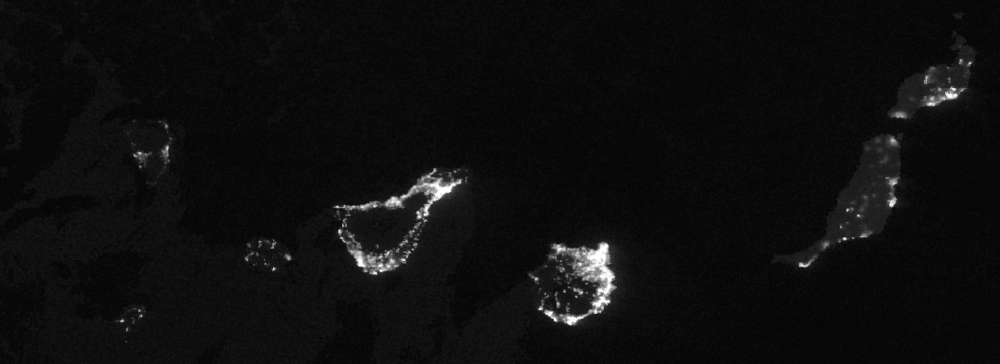  
*Luz nocturna (`luces.png`)*

Al superponerlas se vio que no coincidían. La imagen de relieve cubría una zona algo distinta, así que se estiró y desplazó hasta que las islas encajaron. En la imagen siguiente el relieve está en rojo y la luz en verde.

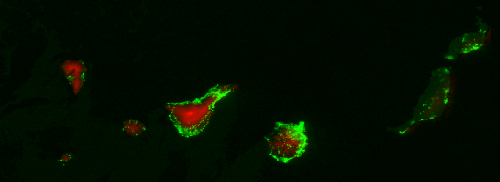  
*Relieve (rojo) y luz (verde) ya alineados*

Comprobé que el mapa de altura es proporcional a la altitud real. El valor 255 corresponde al Teide (3718 m), así que cada nivel de gris son unos 15 metros.

[Volver al índice](#índice)

## Construcción de la escena

El archivo principal es [`script_canarias.js`](src/script_canarias.js). La función `init()` solo llama a otras funciones, cada una con una tarea:

```js
function init() {
  crearEscena();
  crearFondo();
  crearNiebla();
  crearCamara();
  crearRenderer();
  crearControles();
  crearMar();
  crearLuces();
  crearGrupoConos();
  cargarImagenes();
  crearEstrellas();
  crearMenu();
  crearTitulo();
  crearPanelInfo();
  configurarClics();
  configurarResize();
}
```

### Terreno

Es la técnica del ejemplo 21: un plano con muchas subdivisiones (500 x 182) cuyos vértices suben según el brillo de la imagen de relieve (`displacementMap`). Se usa `MeshPhongMaterial`, porque con `MeshStandardMaterial` el desplazamiento no se aplica.

```js
const geom = new THREE.PlaneGeometry(ancho, alto, 500, 182);
matTerreno = new THREE.MeshPhongMaterial({
  color: 0x1a2130,
  displacementMap: relieve,
  displacementScale: escalaRelieve,
  emissive: 0xff9933,
  emissiveMap: luces,
  emissiveIntensity: 2.5,
});
```

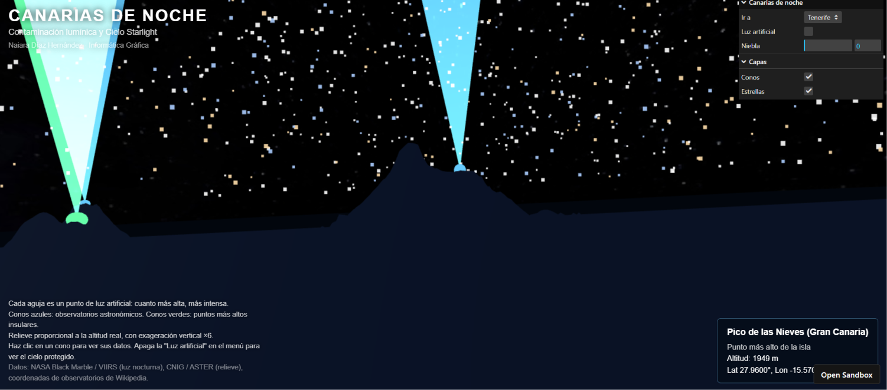  
*La luz direccional baja marca las laderas*

### Luces de las ciudades

La imagen de luz se usa como `emissiveMap`, así que el terreno brilla en naranja solo donde hay luz. Un detalle importante: hay que marcar la textura como sRGB. Sin esa línea, el ruido gris del mar se aclaraba y todo el plano salía naranja.

```js
luces.colorSpace = THREE.SRGBColorSpace;
```

### Agujas de luz

Se lee la imagen de luz píxel a píxel con un `canvas` oculto. Por cada píxel por encima de un umbral se coloca una aguja, que es un cono fino estirado hacia arriba. Todas se dibujan con un `InstancedMesh`, como los asteroides de la práctica 7.

```js
dummy.position.set(x, y, z);
dummy.scale.set(1, 1, 0.05 + t * alturaMax); // la altura depende del brillo
agujas.setMatrixAt(n, dummy.matrix);
color.copy(naranja).lerp(cian, t * t * t);   // las más intensas, en cian
agujas.setColorAt(n, color);
```

La base de cada aguja se apoya en la altura del terreno en ese punto, leída del mapa de relieve.

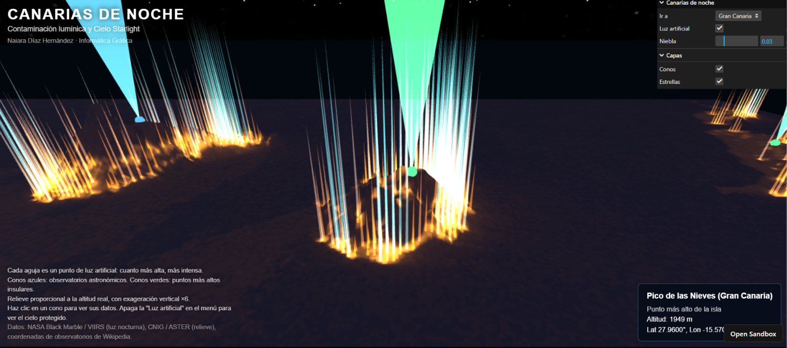  
*Agujas sobre Gran Canaria*

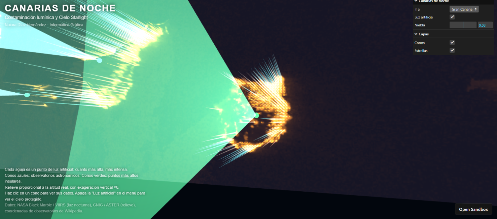  
*Detalle: las más intensas pasan de naranja a cian*

### Observatorios y cumbres desde un CSV

Se lee [`cielo.csv`](src/cielo.csv) con `fetch`, igual que el CSV de estaciones de Sitycleta del ejemplo 24. Cada fila pasa de latitud y longitud a un píxel de la imagen:

```js
const px = Math.round((p.lon - lon0) * pxPorGrado);
const py = Math.round((lat0 - p.lat) * pxPorGrado);
```

En ese píxel se coloca un cono invertido, con la punta en el suelo y la base hacia el cielo. Un color por vértice hace que brille en la punta y se apague hacia arriba. Con `AdditiveBlending` lo oscuro se ve transparente.

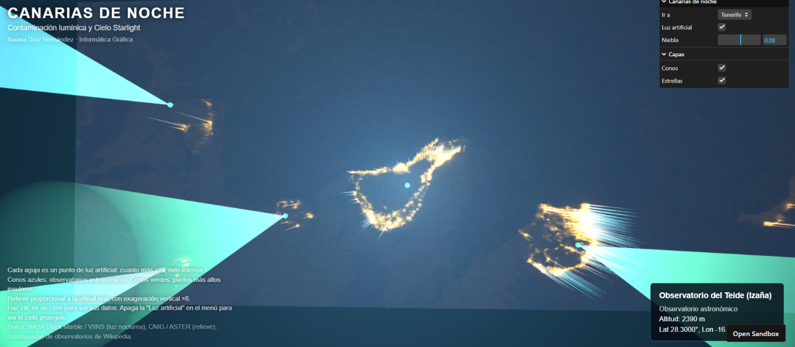  
*Observatorio del Teide*

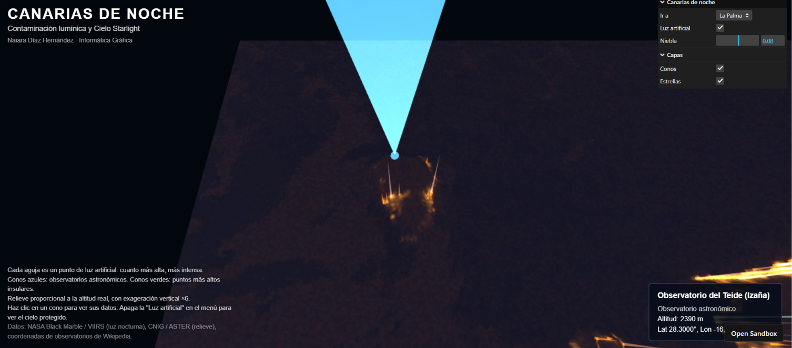  
*Observatorio del Roque de los Muchachos, en La Palma*

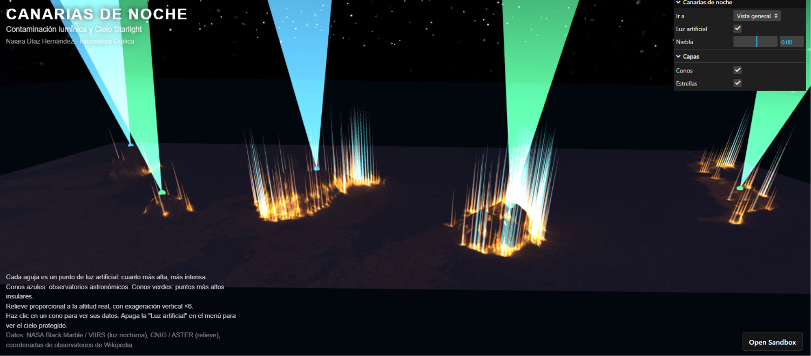  
*Conos verdes en las cumbres de otras islas*

### Estrellas

4000 partículas repartidas en una media esfera sobre el mapa, con colores blancos, azulados y cálidos. Giran muy despacio. Debajo hay una textura de la Vía Láctea.

```js
estrellas = new THREE.Points(geom, mat);
```

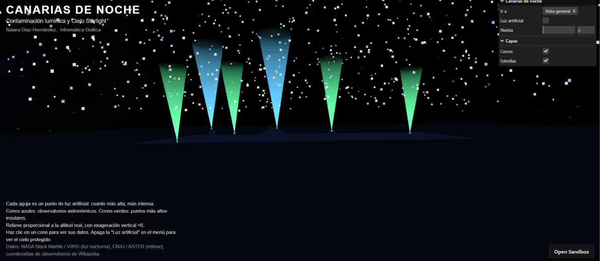  
*El cielo visto desde una cámara baja*

[Volver al índice](#índice)

## Interacción

- **Ratón:** `OrbitControls` para girar y acercar.
- **Menú "Ir a":** la cámara viaja de forma suave hasta la isla elegida.
- **Casilla "Luz artificial":** apaga las luces y las agujas poco a poco y las estrellas crecen.
- **Deslizador "Niebla":** cambia la densidad de la niebla.
- **Capas:** casillas para ocultar los conos o las estrellas.
- **Clic en un cono:** aparece un cuadro con el nombre, la altitud y las coordenadas del punto.

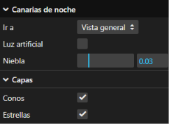  
*Menú de lil-gui*

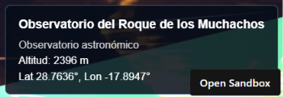  
*Información de un observatorio al hacer clic*

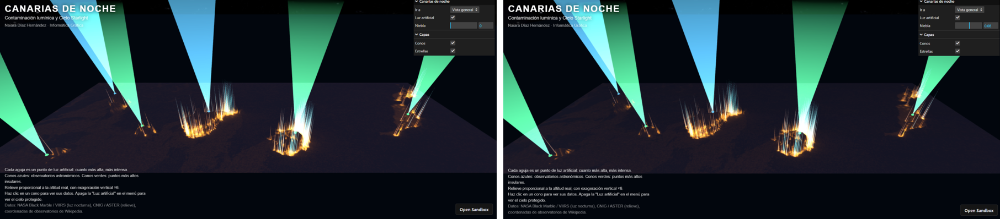  
*Misma escena con niebla a 0 y a 0.08*

El clic se distingue de un arrastre comparando la posición del ratón al pulsar y al soltar, para que girar la cámara no abra el cuadro.

[Volver al índice](#índice)

## Limitaciones

- La imagen de luz es una versión de 8 bits y no la radiancia original.
- La imagen se georreferenció de forma aproximada, con unos 200 píxeles por grado. El error puede ser de algunos kilómetros.
- El relieve es proporcional a la altitud real, pero con una exageración vertical de ×7. La leyenda lo indica.
- La imagen no corrige la proyección por la latitud, así que las islas salen un 13 % más anchas que en la realidad.
- Los conos son simbólicos. Un telescopio no emite un haz de luz.
- Las coordenadas de las cumbres no están contrastadas con una fuente.

Mejoras posibles: descargar luz y relieve con el mismo recuadro de coordenadas, usar un modelo digital del terreno de mayor resolución, y comparar dos años de luz nocturna con un deslizador.

[Volver al índice](#índice)

## Cómo ejecutarlo

Abre el sandbox: [enlace al sandbox](https://codesandbox.io/p/sandbox/practica-s8-8x97gx). No hace falta instalar nada.

En local, con Node instalado:

```
npm install
npm run dev
```

Archivos necesarios en `src/`:

- `script_canarias.js`
- `relieve.png`
- `luces.png`
- `cielo.csv`
- `2k_stars_milky_way.jpg`

[Volver al índice](#índice)

## Referencias

- [Guion de la semana 8](https://github.com/otsedom/otsedom.github.io/tree/main/IG/S8): ejemplos 21 (terreno) y 24 (mapa y CSV).
- [Documentación de three.js](https://threejs.org/docs/index.html)
- [NASA Black Marble](https://www.earthdata.nasa.gov/data/projects/black-marble)
- [NASA Worldview](https://worldview.earthdata.nasa.gov)
- [Tangram Heightmapper](https://tangrams.github.io/heightmapper/)
- [Solar System Scope, texturas](https://www.solarsystemscope.com/textures/)
- [Observatorios de Canarias, IAC](https://ocan.iac.es/?p=187)
- [lil-gui](https://lil-gui.georgealways.com)

