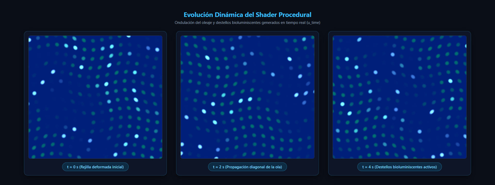
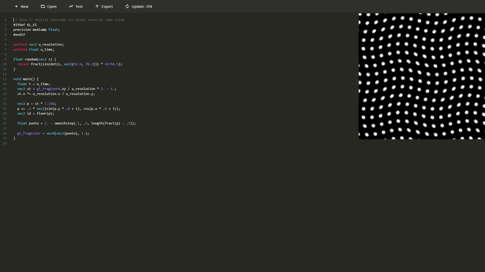
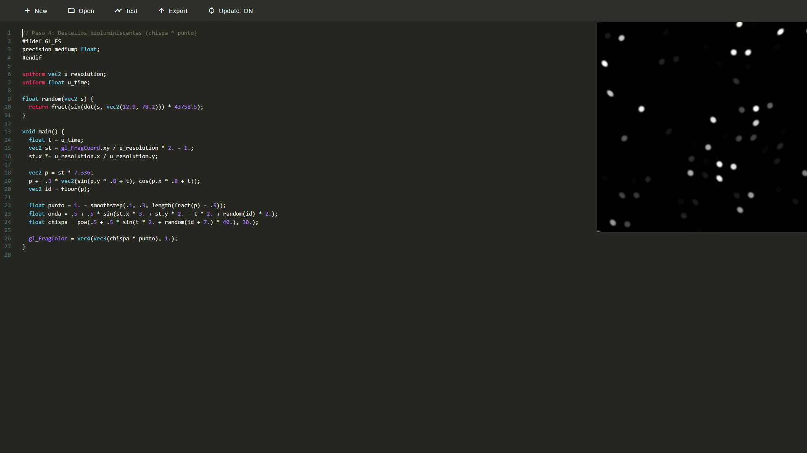
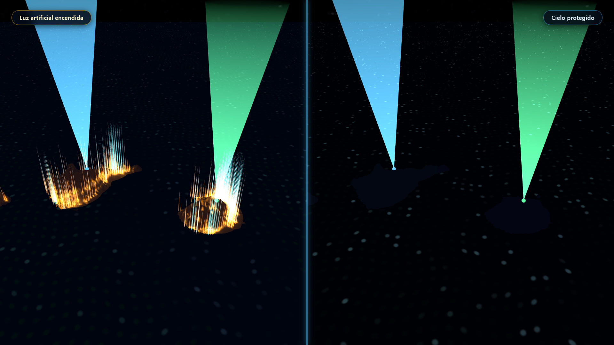
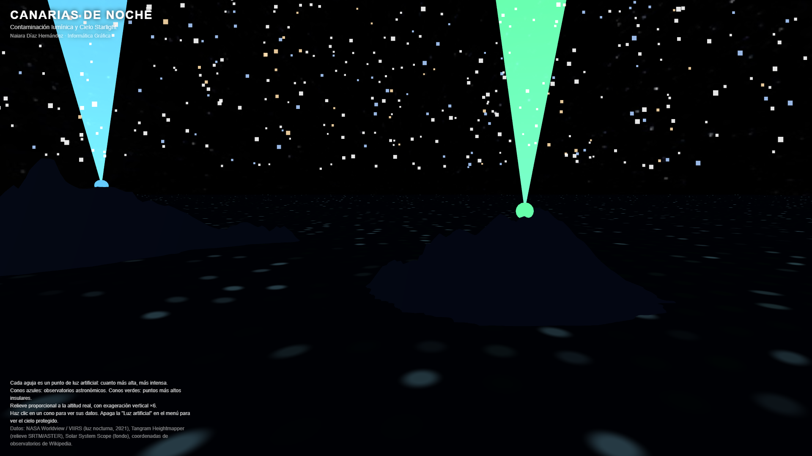

# Mar nocturno digital — Shaders GLSL

Shader de fragmentos procedural en GLSL con oleaje y destellos bioluminiscentes. Incluye una versión *tiny code* de **510 bytes** para *The Book of Shaders*, el desarrollo paso a paso de cómo funciona e integración como `ShaderMaterial` en la escena 3D de las Islas Canarias hecha con Three.js.

Práctica de la semana 9 de Informática Gráfica. Naiara Díaz Hernández, Universidad de Las Palmas de Gran Canaria.

  
*Vista general de la escena con el shader del mar integrado y la luz artificial encendida*

Vídeos:

- **Shader tiny (510 bytes), reel vertical (1080×1920, 15 s):**  
  - Archivo local: [`videos/shader-reel.mp4`](videos/shader-reel.mp4)  
  - YouTube: [Enlace al vídeo del shader](URL_VIDEO_SHADER)
- **Demo interactiva de la escena Three.js (1920×1080, 60 s):**  
  - Archivo local: [`videos/demo-escena.mp4`](videos/demo-escena.mp4)  
  - YouTube: [Enlace al vídeo de la demo](URL_VIDEO_DEMO)

---

## Índice

1. [Motivación e idea visual](#motivación-e-idea-visual)
2. [El shader: versión tiny (510 bytes) y legible](#el-shader-versión-tiny-510-bytes-y-legible)
3. [Desarrollo técnico paso a paso](#desarrollo-técnico-paso-a-paso)
   - [1. Normalización de coordenadas y aspect ratio](#1-normalización-de-coordenadas-y-aspect-ratio)
   - [2. Rejilla celular con floor y fract](#2-rejilla-celular-con-floor-y-fract)
   - [3. Ondulación de la superficie con senos y cosenos](#3-ondulación-de-la-superficie-con-senos-y-cosenos)
   - [4. Puntos circulares suaves con smoothstep](#4-puntos-circulares-suaves-con-smoothstep)
   - [5. Ola diagonal en propagación y desfase aleatorio](#5-ola-diagonal-en-propagación-y-desfase-aleatorio)
   - [6. Destellos bioluminiscentes con potencia (pow)](#6-destellos-bioluminiscentes-con-potencia-pow)
   - [7. Composición cromática y mezcla de color](#7-composición-cromática-y-mezcla-de-color)
4. [Optimización hasta 510 bytes (≤ 512 bytes)](#optimización-hasta-510-bytes--512-bytes)
5. [Extra: Integración en la escena 3D de Canarias (S8)](#extra-integración-en-la-escena-3d-de-canarias-s8)
   - [ShaderMaterial y uniforms dinámicos](#shadermaterial-y-uniforms-dinámicos)
   - [Tabla comparativa: Editor vs. Escena Three.js](#tabla-comparativa-editor-vs-escena-threejs)
   - [Interacción con la Ley del Cielo](#interacción-con-la-ley-del-cielo)
6. [Limitaciones](#limitaciones)
7. [Cómo ejecutarlo](#cómo-ejecutarlo)
8. [Referencias](#referencias)

---

## Motivación e idea visual

En la práctica de la semana 8, el mar que rodea las islas era un plano estático de un color oscuro y plano. Funcionaba, pero la escena nocturna se quedaba sin vida justo en la zona que más ocupa la pantalla. Para esta práctica quise sustituirlo por algo que se moviera y que encajara con el tema, así que me inspiré en la **bioluminiscencia marina**.

En zonas de costa sin contaminación lumínica, cuando el agua se agita, ciertos dinoflagelados emiten pequeños destellos azules y blancos. Intenté llevar esa imagen a un shader procedural: una malla de puntos de luz que ondula con el tiempo, atravesada por frentes de ola diagonales y con chispas que se encienden y se apagan de forma irregular.

El efecto además conecta con el tema de la escena, la **Ley del Cielo** y la contaminación lumínica en Canarias. Con las luces de las ciudades apagadas, el mar queda oscuro y los destellos se ven con más fuerza. Con la luz artificial encendida, el brillo de la costa lava la superficie del agua y la bioluminiscencia casi desaparece.

[Volver al índice](#índice)

---

## El shader: versión tiny (510 bytes) y legible

El proyecto tiene dos versiones del mismo algoritmo:

- [`shaders/mar_nocturno_tiny.frag`](shaders/mar_nocturno_tiny.frag): la versión comprimida, de **510 bytes**, dentro del límite de 512 del reto *tiny code*.
- [`shaders/mar_nocturno_legible.frag`](shaders/mar_nocturno_legible.frag): la versión ordenada y comentada, pensada para entender el código.

Este es el código de la versión tiny:

```glsl
precision mediump float;uniform vec2 u_resolution;uniform float u_time;float r(vec2 s){return fract(sin(dot(s,vec2(12.9,78.2)))*43758.5);}void main(){vec2 s=gl_FragCoord.xy/u_resolution*2.-1.,p,i;float t=u_time;s.x*=u_resolution.x/u_resolution.y;p=s*7.336;p+=.3*vec2(sin(p.y*.8+t),cos(p.x*.8+t));i=floor(p);float d=1.-smoothstep(.1,.3,length(fract(p)-.5));gl_FragColor=vec4(mix(vec3(0,.12,.48),vec3(0,.44,.44),d*(.5+.5*sin(s.x*3.+s.y*2.-t*2.+r(i)*2.)))+vec3(.6,.9,1)*pow(.5+.5*sin(t*2.+r(i+7.)*40.),30.)*d,1);}
```

Se ejecuta tal cual en el editor de *The Book of Shaders*, que solo le da los uniforms `u_resolution` y `u_time`:

  
*El shader tiny (510 bytes) funcionando en el editor de The Book of Shaders*

No usa texturas ni datos externos. Todo el movimiento sale de las funciones matemáticas y del tiempo:

  
*Tres instantes (t ≈ 0 s, 2 s y 4 s). Se ve cómo se deforma la rejilla y cómo se activan los destellos en celdas distintas*

[Volver al índice](#índice)

---

## Desarrollo técnico paso a paso

Para construir el shader me apoyé en lo visto en el guion de la asignatura y en los capítulos de formas, patrones y aleatoriedad de *The Book of Shaders*. El resultado final se puede dividir en siete pasos.

### 1. Normalización de coordenadas y aspect ratio

Primero paso las coordenadas de píxel `gl_FragCoord.xy` a un espacio centrado en el origen, con valores entre -1 y 1. Después multiplico el eje x por la relación de aspecto para que las celdas no se estiren en pantallas anchas ni al redimensionar la ventana:

```glsl
vec2 st = gl_FragCoord.xy / u_resolution * 2. - 1.;
st.x *= u_resolution.x / u_resolution.y;
```

### 2. Rejilla celular con floor y fract

Multiplico el espacio por un factor de escala (7.336) y lo divido en dos partes con `floor` y `fract`:
- `floor(p)` da el identificador entero de cada celda, que uso como semilla para los valores aleatorios.
- `fract(p)` da las coordenadas locales dentro de cada celda, entre 0 y 1.

  
*Paso 1 en el editor: `fract(p)` dibujado en los canales rojo y verde, donde se ve cómo el plano queda dividido en celdas iguales*

### 3. Ondulación de la superficie con senos y cosenos

Una cuadrícula perfecta parece una pantalla LED, no agua. Antes de separar las celdas, deformo las coordenadas sumando senos y cosenos cruzados que dependen del tiempo:

```glsl
p += 0.3 * vec2(sin(p.y * 0.8 + t), cos(p.x * 0.8 + t));
```

Como el desplazamiento en x depende de y, y el de y depende de x, la rejilla se retuerce de forma suave y recuerda al balanceo de la corriente.

### 4. Puntos circulares suaves con smoothstep

En cada celda calculo la distancia al centro con `length(fract(p) - 0.5)`. Si usara `step` el borde saldría duro y pixelado, así que uso `smoothstep(0.1, 0.3, ...)` invertido, que da un núcleo brillante con caída suave hacia el borde:

```glsl
float punto = 1. - smoothstep(0.1, 0.3, length(fract(p) - 0.5));
```

  
*Paso 2 en el editor: con la ondulación activada, `punto` dibujado en escala de grises*

### 5. Ola diagonal en propagación y desfase aleatorio

Si todos los puntos brillaran igual a la vez, el efecto quedaría plano. Para evitarlo añado una onda que avanza en diagonal (3x + 2y - 2t) y le sumo un desfase aleatorio distinto para cada celda, sacado de `random(id)`:

```glsl
float onda = 0.5 + 0.5 * sin(st.x * 3. + st.y * 2. - t * 2. + random(id) * 2.);
```

La función `random` es la clásica de *The Book of Shaders*, basada en el producto escalar y en la parte fraccionaria de un seno:

```glsl
float random(vec2 s) {
  return fract(sin(dot(s, vec2(12.9, 78.2))) * 43758.5);
}
```

  
*Paso 3 en el editor: la variable `onda` en grises, con el gradiente oblicuo y las diferencias entre celdas*

### 6. Destellos bioluminiscentes con potencia (pow)

La bioluminiscencia real es así: casi nada la mayor parte del tiempo y de golpe una chispa breve. Para imitarlo elevo una señal sinusoidal a una potencia alta (30):

```glsl
float chispa = pow(0.5 + 0.5 * sin(t * 2. + random(id + 7.) * 40.), 30.);
```

La base `0.5 + 0.5 * sin(...)` oscila suavemente entre 0 y 1. Al elevarla a 30, el resultado se queda muy cerca de cero durante la mayor parte del ciclo. Por ejemplo, solo supera 0.05 en torno al 20 % del tiempo y solo pasa de 0.5 en torno al 10 %. Así cada celda se enciende en un pico corto. Como cada una usa una semilla distinta (`id + 7.`) y se multiplica por 40, los parpadeos quedan descoordinados entre celdas.

  
*Paso 4 en el editor: el término `chispa * punto`, donde solo brillan las celdas que están en su pico*

### 7. Composición cromática y mezcla de color

Para el color uso tres tonos:
- **Azul abisal:** `vec3(0.0, 0.12, 0.48)`, el fondo del agua.
- **Turquesa:** `vec3(0.0, 0.44, 0.44)`, el oleaje activo.
- **Blanco cian:** `vec3(0.6, 0.9, 1.0)`, las chispas más intensas.

Con `mix()` mezclo el azul y el turquesa según la intensidad de la ola, y después sumo el destello en el centro de cada punto:

```glsl
vec3 color = mix(oscuro, claro, punto * onda);
color += brillo * chispa * punto;
gl_FragColor = vec4(color, 1.);
```

[Volver al índice](#índice)

---

## Optimización hasta 510 bytes (≤ 512 bytes)

El enunciado valora el *tiny code* de hasta 512 bytes, contando los uniforms. La versión legible tiene más de 1.500 caracteres, así que fui reduciéndola sin cambiar el resultado visual. Estas fueron las técnicas que usé:

1. **Declarar juntas las variables del mismo tipo:** `vec2 s=...,p,i;` en una sola sentencia en vez de tres.
2. **Quitar el cero inicial en los flotantes:** `.3`, `.8`, `.1`, `.44`, etc.
3. **Enteros dentro de constructores:** en `vec3(0,.12,.48)` o `vec3(.6,.9,1)` el constructor convierte los enteros a flotante, así que me ahorro el punto decimal. Lo uso solo dentro de constructores. En asignaciones y operaciones sigo escribiendo flotantes con punto, como recomienda el guion, para evitar errores de conversión según la tarjeta gráfica.
4. **Nombres de una letra:** `random` pasa a `r`, las coordenadas normalizadas a `s`, la posición a `p`, el id de celda a `i` y el punto a `d`.
5. **Meter las expresiones directamente en `gl_FragColor`:** desaparecen las variables intermedias `onda`, `chispa`, `oscuro`, `claro` y `color`.
6. **Quitar espacios y saltos de línea** salvo los que separan palabras clave (`float`, `vec2`, `return`, `void`).
7. **Mantener los nombres estándar `u_resolution` y `u_time`** para que funcione en cualquier editor GLSL sin cambios.

El archivo [`shaders/mar_nocturno_tiny.frag`](shaders/mar_nocturno_tiny.frag) ocupa **510 bytes** en disco, comprobado con la propia consola:

  
*Comprobación del tamaño: 510 bytes, por debajo del límite de 512*

[Volver al índice](#índice)

---

## Extra: Integración en la escena 3D de Canarias (S8)

Como extra, metí el shader en la visualización 3D de las Islas Canarias que hice en la práctica anterior con Three.js. En esa escena el relieve se construye desplazando vértices a partir de modelos de elevación, y las luces urbanas salen de texturas del sensor VIIRS (NASA Black Marble). Los conos de luz marcan los observatorios del Teide y del Roque de los Muchachos.

### ShaderMaterial y uniforms dinámicos

Para reemplazar el mar estático creé un `THREE.ShaderMaterial` y se lo asigné a un plano grande (40 × 40 unidades) colocado a la altura del mar (z = 0.005).

El shader de vértices pasa la posición del plano al de fragmentos mediante un varying:

```glsl
varying vec2 vP;
void main() {
  vP = position.xy;
  gl_Position = projectionMatrix * modelViewMatrix * vec4(position, 1.0);
}
```

El shader de fragmentos de la escena declara, además de lo que ya conocemos del editor, el varying y los uniforms propios de la integración:

```glsl
varying vec2 vP;
uniform float u_time;
uniform float u_luz;
```

En cada fotograma, el bucle de render actualiza el tiempo:

```js
matMar.uniforms.u_time.value = performance.now() / 1000;
```

### Tabla comparativa: Editor vs. Escena Three.js

Al pasar el código del editor a la escena 3D tuve que cambiar algunas cosas:

| Concepto | Editor (*The Book of Shaders*) | Escena 3D (*Three.js*) |
|---|---|---|
| **Sistema de coordenadas** | Píxeles de pantalla (`gl_FragCoord.xy`) | Coordenadas del plano en espacio objeto (`varying vec2 vP`) |
| **Corrección de aspecto** | Necesaria: `st.x *= u_resolution.x / u_resolution.y` | No hace falta: el plano ya tiene unidades homogéneas |
| **Escala de repetición** | Fija, 7.336 sobre la ventana | s = vP · 0.45 y p = s · 15.0 (unas 6.75 celdas por unidad) |
| **Uniform de tiempo** | Lo da el editor (`u_time`) | Se actualiza desde JS con `performance.now() / 1000` |
| **Interacción con la luz** | Ninguna, el shader es independiente | Uniform `u_luz`, ligado al control de contaminación lumínica |

### Interacción con la Ley del Cielo

El uniform `u_luz` va de 1.0 (luz urbana encendida) a 0.0 (cielo protegido), con una transición suave cuando se activa la casilla del panel de control:

```js
if (matMar) matMar.uniforms.u_luz.value = luzNivel;
```

En el shader, `u_luz` afecta tanto al brillo del agua como a la intensidad de los destellos:

```glsl
// Fondo del mar: se oscurece al apagar las luces artificiales
vec3 c = mix(oscuro, claro, d * onda) * mix(0.04, 0.12, u_luz);

// Destellos bioluminiscentes: se duplican en la oscuridad (de 0.12 a 0.25)
c += brillo * chispa * d * mix(0.25, 0.12, u_luz);
```

  
*A la izquierda, el resplandor de las ciudades aclara el mar. A la derecha, con el cielo protegido, el agua queda más oscura y los destellos destacan más*

La diferencia se nota más al acercar la cámara a la costa:

  
*Vista rasante del mar con la luz artificial encendida (`teleportCamera(0.5, -2.5, 0.35, 0.5, 0, 0.1)`)*

  
*Misma posición con la luz artificial apagada: más contraste en los puntos del agua y destellos más claros*

[Volver al índice](#índice)

---

## Limitaciones

- **Precisión en móviles:** la función aleatoria `fract(sin(...) * 43758.5453)` depende de la precisión en coma flotante de la GPU. En tarjetas o controladores móviles con precisión reducida pueden aparecer patrones repetidos que no deberían estar.
- **Repetición a gran escala:** como se basa en senos y no en ruido Perlin o Simplex, en vistas muy lejanas se pueden notar bandas regulares de interferencia.
- **Sin niebla de Three.js:** el mar usa un `ShaderMaterial` propio que no incluye el chunk `fog_fragment`, así que el deslizador de densidad de niebla no afecta al horizonte del agua.
- **Versión tiny difícil de depurar:** al quitar espacios y usar nombres de una letra, `shaders/mar_nocturno_tiny.frag` es muy incómodo de leer. Para cualquier cambio hay que trabajar sobre `shaders/mar_nocturno_legible.frag`.

[Volver al índice](#índice)

---

## Cómo ejecutarlo

### En el editor web de The Book of Shaders
No hace falta instalar nada:
1. Abrir el editor: [http://editor.thebookofshaders.com](http://editor.thebookofshaders.com).
2. Borrar el código inicial y pegar el contenido de [`shaders/mar_nocturno_tiny.frag`](shaders/mar_nocturno_tiny.frag) (o de [`shaders/mar_nocturno_legible.frag`](shaders/mar_nocturno_legible.frag)).
3. El editor lo compila y lo ejecuta automáticamente.

### Escena 3D completa (Three.js)

#### En CodeSandbox
Se puede ver la escena completa, con relieve, iluminación nocturna y el shader del mar, directamente en el navegador:
- **Sandbox:** [https://codesandbox.io/p/devbox/practica-s8-forked-xwlynk?workspaceId=ws_DCHKvkQUtznGkewsQK8dw](https://codesandbox.io/p/devbox/practica-s8-forked-xwlynk?workspaceId=ws_DCHKvkQUtznGkewsQK8dw)

#### En local (Node.js)
Clonar o descargar el repositorio y ejecutar en la raíz:

```bash
npm install
npm run dev
```

El servidor local suele arrancar en [http://localhost:5173/](http://localhost:5173/).

Archivos principales:
- `shaders/mar_nocturno_tiny.frag`: shader minificado de 510 bytes.
- `shaders/mar_nocturno_legible.frag`: shader comentado.
- `images/`: capturas y composiciones de la práctica.
- `videos/`: grabaciones MP4 a 30 fps sin audio (`shader-reel.mp4` y `demo-escena.mp4`).

[Volver al índice](#índice)

---

## Referencias

- [Guion de la semana 9 de Informática Gráfica](https://github.com/otsedom/otsedom.github.io/tree/main/IG/S9): fragment shaders en GLSL, patrones generativos y tiny coding.
- [Guion de la semana 8 de Informática Gráfica](https://github.com/otsedom/otsedom.github.io/tree/main/IG/S8): modelos de elevación y visualización 3D en Three.js.
- [The Book of Shaders](https://thebookofshaders.com) (Patricio Gonzalez Vivo y Jen Lowe):
  - [Capítulo 05: Colores](https://thebookofshaders.com/05/?lan=es)
  - [Capítulo 09: Patrones](https://thebookofshaders.com/09/?lan=es)
  - [Capítulo 10: Aleatoriedad](https://thebookofshaders.com/10/?lan=es)
- [Editor interactivo de The Book of Shaders](http://editor.thebookofshaders.com)
- [Documentación de Three.js: ShaderMaterial](https://threejs.org/docs/#api/en/materials/ShaderMaterial)
- [Khronos Group: The OpenGL ES Shading Language (GLSL ES 1.00 / 3.00)](https://www.khronos.org/registry/OpenGL/specs/es/)
- [NASA Earth Observatory / Black Marble: VIIRS Nighttime Lights](https://earthobservatory.nasa.gov/features/NightLights)

***
Grado en Ingeniería Informática  
Naiara Díaz Hernández — Informática Gráfica
