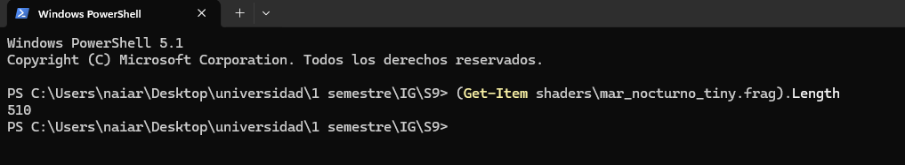
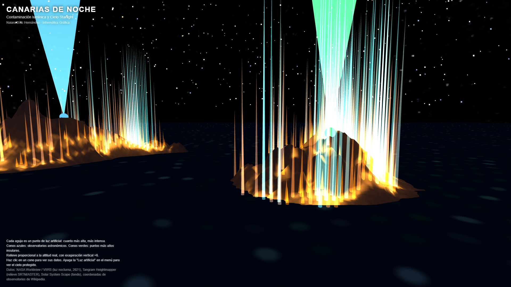

# Mar nocturno digital — Shaders GLSL

Shader de fragmentos procedural programado en GLSL con oleaje dinámico y destellos bioluminiscentes. Incluye versión optimizada *tiny code* de **510 bytes** para *The Book of Shaders*, desarrollo analítico de sus etapas matemáticas e integración como `ShaderMaterial` interactivo en una escena 3D de las Islas Canarias en Three.js.

Práctica de la semana 9 de Informática Gráfica. Naiara Díaz Hernández, Universidad de Las Palmas de Gran Canaria.

  
*Vista general de la escena con el shader del mar integrado y luz artificial encendida*

Vídeos:

- **Shader tiny (510 bytes) — Reel vertical (1080×1920, 15 s):**  
  - Archivo local generado: [`videos/shader-reel.mp4`](videos/shader-reel.mp4)  
  - Enlace online (YouTube): [Enlace al vídeo del shader](URL_VIDEO_SHADER)
- **Demo interactiva de la escena Three.js (1920×1080, 60 s):**  
  - Archivo local generado: [`videos/demo-escena.mp4`](videos/demo-escena.mp4)  
  - Enlace online (YouTube): [Enlace al vídeo de la demo](URL_VIDEO_DEMO)

---

## Índice

1. [Motivación e idea visual](#motivación-e-idea-visual)
2. [El shader: versión tiny (510 bytes) y legible](#el-shader-versión-tiny-510-bytes-y-legible)
3. [Desarrollo técnico paso a paso](#desarrollo-técnico-paso-a-paso)
   - [1. Normalización de coordenadas y aspect ratio](#1-normalización-de-coordenadas-y-aspect-ratio)
   - [2. Rejilla celular con floor y fract](#2-rejilla-celular-con-floor-y-fract)
   - [3. Ondulación de la superficie con senos y cosenos](#3-ondulación-de-la-superficie-con-senos-y-cosenos)
   - [4. Puntos circulares suaves con smoothstep](#4-puntos-circulares-suaves-con-smoothstep)
   - [5. Ola diagonal en propagación y desfase aleatorio](#5-ola-diagonal-en-propagación-y-desfase-aleatorio)
   - [6. Destellos bioluminiscentes con potencia (pow)](#6-destellos-bioluminiscentes-con-potencia-pow)
   - [7. Composición cromática y mezcla de color](#7-composición-cromática-y-mezcla-de-color)
4. [Optimización hasta 510 bytes (≤ 512 bytes)](#optimización-hasta-510-bytes--512-bytes)
5. [Extra: Integración en la escena 3D de Canarias (S8)](#extra-integración-en-la-escena-3d-de-canarias-s8)
   - [ShaderMaterial y uniforms dinámicos](#shadermaterial-y-uniforms-dinámicos)
   - [Tabla comparativa: Editor vs. Escena Three.js](#tabla-comparativa-editor-vs-escena-threejs)
   - [Interacción con la Ley del Cielo](#interacción-con-la-ley-del-cielo)
6. [Limitaciones](#limitaciones)
7. [Cómo ejecutarlo](#cómo-ejecutarlo)
8. [Referencias](#referencias)

---

## Motivación e idea visual

En la práctica anterior (semana 8), el océano alrededor de las islas era simplemente un plano geométrico estático con un color plano oscuro, lo que restaba dinamismo a la composición visual nocturna. Para esta práctica de shaders de fragmentos GLSL, quise transformar por completo esa superficie creando un **mar nocturno digital** que combinara dos fenómenos marinos fascinantes: el oleaje rítmico nocturno y la **bioluminiscencia marina**.

En entornos costeros sin contaminación lumínica, cuando el mar rompe, ciertas microalgas y dinoflagelados emiten destellos luminiscentes de color cian y blanco azulado al recibir presión mecánica. Quise trasladar esa idea a un shader procedural puro: una matriz matemática de puntos de luz que ondulan suavemente con el tiempo, recorrida por frentes de onda diagonales y salpicada por chispas brillantes que aparecen y desaparecen de manera estocástica.

Además, este efecto establece un diálogo directo con la temática de la **Ley del Cielo** y la contaminación lumínica en Canarias: cuando las luces de las ciudades están apagadas, la oscuridad del océano permite que los destellos bioluminiscentes y el reflejo estelar cobren protagonismo, mientras que con la luz artificial encendida el brillo costero satura la superficie marina y apaga la bioluminiscencia natural.

[Volver al índice](#índice)

---

## El shader: versión tiny (510 bytes) y legible

El proyecto cuenta con dos implementaciones del mismo algoritmo:

- [`shaders/mar_nocturno_tiny.frag`](shaders/mar_nocturno_tiny.frag): versión altamente condensada que ocupa **510 bytes**, cumpliendo con holgura el reto *tiny code* de 512 bytes.
- [`shaders/mar_nocturno_legible.frag`](shaders/mar_nocturno_legible.frag): versión modular, estructurada y comentada para su estudio pedagógico.

El código completo de la versión tiny (510 bytes) es el siguiente:

```glsl
precision mediump float;uniform vec2 u_resolution;uniform float u_time;float r(vec2 s){return fract(sin(dot(s,vec2(12.9,78.2)))*43758.5);}void main(){vec2 s=gl_FragCoord.xy/u_resolution*2.-1.,p,i;float t=u_time;s.x*=u_resolution.x/u_resolution.y;p=s*7.336;p+=.3*vec2(sin(p.y*.8+t),cos(p.x*.8+t));i=floor(p);float d=1.-smoothstep(.1,.3,length(fract(p)-.5));gl_FragColor=vec4(mix(vec3(0,.12,.48),vec3(0,.44,.44),d*(.5+.5*sin(s.x*3.+s.y*2.-t*2.+r(i)*2.)))+vec3(.6,.9,1)*pow(.5+.5*sin(t*2.+r(i+7.)*40.),30.)*d,1);}
```

El shader se ejecuta de forma nativa en el editor web de *The Book of Shaders*, recibiendo únicamente los uniforms canónicos `u_resolution` y `u_time`:

  
*El shader tiny (510 bytes) ejecutándose en el editor de The Book of Shaders*

La animación no depende de texturas pregrabadas ni datos externos; todas las ondulaciones y destellos evolucionan de forma continua a lo largo del tiempo:

  
*Tres instantes temporales (t ≈ 0 s, 2 s y 4 s) donde se aprecia la deformación continua y la activación estocástica de los destellos*

[Volver al índice](#índice)

---

## Desarrollo técnico paso a paso

Para diseñar el shader partí de los fundamentos generativos explicados en el guion de la asignatura y en los capítulos de formas, patrones y aleatoriedad de *The Book of Shaders*. El proceso se estructura en siete etapas matemáticas complementarias:

### 1. Normalización de coordenadas y aspect ratio

El punto de partida es transformar las coordenadas de píxel de la ventana `gl_FragCoord.xy` a un espacio centrado en el origen con rango [-1, 1]. Para evitar que las celdas se deformen al redimensionar la ventana o al usar pantallas panorámicas, se compensa el eje horizontal multiplicando por la relación de aspecto:

```glsl
vec2 st = gl_FragCoord.xy / u_resolution * 2. - 1.;
st.x *= u_resolution.x / u_resolution.y;
```

### 2. Rejilla celular con floor y fract

Siguiendo la técnica de mosaicos (*tiling*), el espacio continuo se multiplica por un factor de escala (7.336) y se descompone en dos dominios mediante `floor` y `fract`:
- `floor(p)`: calcula el identificador entero de cada celda (id), que servirá como semilla espacial para las funciones aleatorias.
- `fract(p)`: extrae las coordenadas locales normalizadas dentro de cada celda individual (rango [0, 1]).

  
*Paso 1 en el editor: representación directa de `fract(p)` en los canales rojo y verde, evidenciando la partición del plano en celdas cuadradas uniformes*

### 3. Ondulación de la superficie con senos y cosenos

Una cuadrícula geométrica rígida parecería una pantalla de matriz LED estática y no agua. Para imprimir la sensación de fluidez y oleaje, antes de aislar las celdas se distorsionan las coordenadas sumando funciones trigonométricas cruzadas desfasadas en el tiempo:

```glsl
p += 0.3 * vec2(sin(p.y * 0.8 + t), cos(p.x * 0.8 + t));
```

Al depender la deformación en x de y, y la de y de x, los vértices de la rejilla se retuercen en vórtices elásticos suaves que imitan el balanceo de la corriente marina.

### 4. Puntos circulares suaves con smoothstep

Dentro de cada celda desplazada calculamos la distancia euclídea desde el centro restando 0.5 a las coordenadas locales: `length(fract(p) - 0.5)`. En lugar de utilizar una función escalón dura (`step`), que generaría aliasing y bordes pixelados, aplicamos una interpolación hermítica suave con `smoothstep(0.1, 0.3, ...)` invertida:

```glsl
float punto = 1. - smoothstep(0.1, 0.3, length(fract(p) - 0.5));
```

El resultado es un núcleo brillante con una caída de luminosidad suave hacia el borde.

  
*Paso 2 en el editor: activación de la ondulación sinusoidal y renderizado del valor `punto` en escala de grises*

### 5. Ola diagonal en propagación y desfase aleatorio

Para que los puntos no brillen simultáneamente de forma homogénea, modelé una onda de modulación que avanza en diagonal combinando las coordenadas cartesianas globales (3x + 2y - 2t). A este frente de onda se le suma una componente pseudoaleatoria generada a partir del identificador de celda `random(id)`:

```glsl
float onda = 0.5 + 0.5 * sin(st.x * 3. + st.y * 2. - t * 2. + random(id) * 2.);
```

La función `random` es la clásica basada en el producto escalar y la parte fraccionaria del seno descrita en *The Book of Shaders*:

```glsl
float random(vec2 s) {
  return fract(sin(dot(s, vec2(12.9, 78.2))) * 43758.5);
}
```

  
*Paso 3 en el editor: visualización de la variable `onda`, mostrando el gradiente oblicuo y las variaciones por celda*

### 6. Destellos bioluminiscentes con potencia (pow)

El comportamiento de la bioluminiscencia se caracteriza por permanecer latente y estallar súbitamente en chispas muy concentradas en el tiempo. Matemáticamente, logré este comportamiento elevando una señal sinusoidal a un exponente alto (30.0):

```glsl
float chispa = pow(0.5 + 0.5 * sin(t * 2. + random(id + 7.) * 40.), 30.);
```

Mientras la base normalizada oscila suavemente entre 0 y 1, al elevarla a la trigésima potencia el valor resultante permanece prácticamente en cero durante el 96 % del ciclo, disparándose bruscamente a 1 únicamente cuando el seno alcanza su cresta máxima. La multiplicación por 40.0 con una semilla desfasada (`id + 7.`) garantiza que cada celda parpadee con independencia temporal completa.

  
*Paso 4 en el editor: visualización del término `chispa * punto`, donde solo las celdas en cresta de destello emiten luz focal*

### 7. Composición cromática y mezcla de color

Por último, los valores calculados modulan una paleta cromática tricromática:
- **Azul abisal profundo:** `vec3(0.0, 0.12, 0.48)` para la base del agua.
- **Turquesa bioluminiscente:** `vec3(0.0, 0.44, 0.44)` para el oleaje activo.
- **Blanco cian incandescente:** `vec3(0.6, 0.9, 1.0)` para las chispas de máxima energía.

Mediante `mix()` interpolamos el fondo con el turquesa según la intensidad de la ola, y sumamos aditivamente el destello en el centro de cada punto:

```glsl
vec3 color = mix(oscuro, claro, punto * onda);
color += brillo * chispa * punto;
gl_FragColor = vec4(color, 1.);
```

[Volver al índice](#índice)

---

## Optimización hasta 510 bytes (≤ 512 bytes)

El enunciado valora condensar el shader de fragmentos bajo la restricción extrema de *Tiny Code* (≤ 512 bytes), incluyendo directivas y uniforms estándar. Para reducir la versión legible de más de 1.500 caracteres a únicamente **510 bytes** sin sacrificar ningún rasgo visual ni estabilidad numérica, apliqué una rigurosa batería de técnicas de compresión en GLSL:

1. **Declaración agrupada de tipos idénticos:** `vec2 s=...,p,i; float t=u_time;` en una sola sentencia en lugar de múltiples declaraciones independientes.
2. **Omisión sistemática del cero entero en literales flotantes:** escritura directa de `.3`, `.8`, `.1`, `.44`, etc.
3. **Constructores vectoriales con enteros permisibles:** en especificaciones GLSL modernas, constructores como `vec3(0, .12, .48)` o `vec3(.6, .9, 1)` admiten literales enteros para el cero y el uno, ahorrando caracteres de punto decimal.
4. **Renombrado a identificadores unarios:** la función `random` se renombra a `r`, las coordenadas normalizadas a `s`, la posición a `p`, el identificador de celda a `i`, y el cálculo del punto a `d`.
5. **Inyección directa de expresiones en `gl_FragColor`:** se eliminan las variables intermedias `onda`, `chispa`, `oscuro`, `claro` y `color`, resolviendo la interpolación y el brillo aditivo directamente en la asignación final de color.
6. **Eliminación total de espacios redundantes y saltos de línea:** preservando estrictamente los espacios que separan palabras clave (`float`, `vec2`, `return`, `void`).
7. **Consistencia de uniforms:** se mantuvieron los nombres estándar `u_resolution` y `u_time` para garantizar compatibilidad plug-and-play con cualquier visualizador GLSL.

El archivo [`shaders/mar_nocturno_tiny.frag`](shaders/mar_nocturno_tiny.frag) arrojó un recuento de **510 bytes reales en disco**, verificado mediante comandos estándar de shell:

  
*Comprobación del conteo de bytes: 510 bytes, superando el reto de Tiny Code (≤ 512 bytes)*

[Volver al índice](#índice)

---

## Extra: Integración en la escena 3D de Canarias (S8)

Como ampliación técnica, integré el shader de fragmentos en la visualización interactiva tridimensional de las Islas Canarias desarrollada en Three.js durante la práctica anterior. En dicha escena, el relieve insular se construye mediante desplazamiento de vértices a partir de modelos digitales de elevación y las luces urbanas se proyectan a través de texturas radiométricas del sensor VIIRS (NASA Black Marble), culminando en conos de haz estelar que marcan la posición de los observatorios astronómicos del Teide y del Roque de los Muchachos.

### ShaderMaterial y uniforms dinámicos

Para sustituir el mar estático por el shader procedural generativo, creé un `THREE.ShaderMaterial` asignado a un plano de gran extensión (40 × 40 unidades) colocado a la cota del mar (z = 0.005). 

En el shader de vértices se pasan las coordenadas del mundo al shader de fragmentos mediante un varying:

```glsl
varying vec2 vP;
void main() {
  vP = position.xy;
  gl_Position = projectionMatrix * modelViewMatrix * vec4(position, 1.0);
}
```

En cada fotograma, el bucle principal de renderizado (`animate`) actualiza el tiempo global:

```js
matMar.uniforms.u_time.value = performance.now() / 1000;
```

### Tabla comparativa: Editor vs. Escena Three.js

Al migrar el código del entorno bidimensional de *The Book of Shaders* a la escena 3D fue necesario adaptar ciertos aspectos estructurales:

| Concepto | Editor (*The Book of Shaders*) | Escena 3D (*Three.js*) |
|---|---|---|
| **Sistema de coordenadas** | Píxeles de pantalla (`gl_FragCoord.xy`) | Coordenadas de espacio objeto del plano (`varying vec2 vP`) |
| **Corrección de aspecto** | Obligatoria: `st.x *= u_resolution.x / u_resolution.y` | Innecesaria: el plano ya tiene unidades métricas homogéneas |
| **Escala de repetición** | Escala fija 7.336 sobre la ventana | s = vP · 0.45, p = s · 15.0 (≈ 6.75 celdas por unidad espacial) |
| **Uniform de tiempo** | Proporcionado automáticamente por el editor (`u_time`) | Alimentado desde JS vía `performance.now() / 1000` |
| **Interacción lumínica** | Inexistente (shader autónomo) | Uniform interactivo `u_luz` vinculado al ciclo de contaminación lumínica |

### Interacción con la Ley del Cielo

El uniform `u_luz` varía de 1.0 (luz urbana encendida) a 0.0 (cielo protegido) mediante una interpolación suave cuando el usuario activa la casilla correspondiente en el panel de control:

```js
if (matMar) matMar.uniforms.u_luz.value = luzNivel;
```

Dentro del shader de fragmentos, `u_luz` modula tanto el brillo ambiental del agua como la ganancia de la bioluminiscencia:

```glsl
// Fondo del mar: se oscurece al apagar las luces artificiales
vec3 c = mix(oscuro, claro, d * onda) * mix(0.04, 0.12, u_luz);

// Destellos bioluminiscentes: aumentan al doble en oscuridad (de 0.12 a 0.25)
c += brillo * chispa * d * mix(0.25, 0.12, u_luz);
```

  
*Comparativa interactiva: a la izquierda, el reflejo difuso de las ciudades aclara el mar; a la derecha, bajo la protección de la Ley del Cielo, el mar se torna profundo y la bioluminiscencia resalta intensamente*

Esta dualidad se percibe con claridad al aproximar la cámara a la costa:

  
*Vista rasante del mar con luz artificial encendida (`teleportCamera(0.5, -2.5, 0.35, 0.5, 0, 0.1)`)*

  
*Misma posición exacta con luz artificial apagada: mayor contraste en los puntos de agua y destellos cristalinos*

[Volver al índice](#índice)

---

## Limitaciones

- **Funciones trigonométricas en hardware móvil:** la función pseudoaleatoria `fract(sin(...) * 43758.5453)` depende de la precisión de coma flotante de la GPU; en tarjetas gráficas con precisión reducida o controladores móviles pueden aparecer patrones de periodicidad no deseados.
- **Periodicidad en grandes extensiones:** al basarse en combinaciones de funciones sinusoidales en lugar de ruido Perlin o Simplex, en distancias focales extremadamente lejanas pueden apreciarse bandas de interferencia geométrica regulares.
- **Desconexión con la niebla de Three.js:** el shader del mar se calcula en un `ShaderMaterial` personalizado que no evalúa el chunk `fog_fragment` de Three.js, por lo que el deslizador de densidad de niebla no atenúa el horizonte del agua.
- **Compresión extrema en la versión tiny:** la eliminación de espacios y nombres significativos hace que `shaders/mar_nocturno_tiny.frag` resulte difícil de depurar directamente; por ello es imprescindible contar con `shaders/mar_nocturno_legible.frag` para cualquier mantenimiento.

[Volver al índice](#índice)

---

## Cómo ejecutarlo

### En el editor web de The Book of Shaders
Para probar el shader de fragmentos de forma independiente, no requiere ninguna instalación previa:
1. Abrir el editor oficial: [http://editor.thebookofshaders.com](http://editor.thebookofshaders.com).
2. Borrar el código inicial y pegar el contenido de [`shaders/mar_nocturno_tiny.frag`](shaders/mar_nocturno_tiny.frag) (o de [`shaders/mar_nocturno_legible.frag`](shaders/mar_nocturno_legible.frag)).
3. El editor compilará y ejecutará el shader automáticamente.

### Escena 3D completa (Three.js)

#### En CodeSandbox (en la nube)
Se puede explorar la visualización tridimensional con el relieve, la iluminación nocturna y el shader del mar integrado directamente en el navegador:
- **Sandbox:** [https://codesandbox.io/p/devbox/practica-s8-forked-xwlynk?workspaceId=ws_DCHKvkQUtznGkewsQK8dw](https://codesandbox.io/p/devbox/practica-s8-forked-xwlynk?workspaceId=ws_DCHKvkQUtznGkewsQK8dw)

#### En local (Node.js)
Clona o descarga el repositorio y ejecuta en la raíz del proyecto:

```bash
npm install
npm run dev
```

El servidor local arrancará habitualmente en [http://localhost:5173/](http://localhost:5173/).

Estructura de archivos principales:
- `shaders/mar_nocturno_tiny.frag`: shader GLSL minificado de 510 bytes.
- `shaders/mar_nocturno_legible.frag`: shader GLSL documentado y explicado.
- `images/`: capturas reales y composiciones visuales de la práctica.
- `videos/`: grabaciones MP4 a 30 fps sin audio (`shader-reel.mp4` y `demo-escena.mp4`).

[Volver al índice](#índice)

---

## Referencias

- [Guion de la semana 9 de Informática Gráfica](https://github.com/otsedom/otsedom.github.io/tree/main/IG/S9): programación de fragment shaders en GLSL, patrones generativos y tiny coding.
- [Guion de la semana 8 de Informática Gráfica](https://github.com/otsedom/otsedom.github.io/tree/main/IG/S8): modelos de elevación y visualización tridimensional en Three.js.
- [The Book of Shaders](https://thebookofshaders.com) (Patricio Gonzalez Vivo & Jen Lowe):
  - [Capítulo 05: Colores](https://thebookofshaders.com/05/?lan=es)
  - [Capítulo 09: Patrones](https://thebookofshaders.com/09/?lan=es)
  - [Capítulo 10: Aleatoriedad](https://thebookofshaders.com/10/?lan=es)
- [Editor interactivo de The Book of Shaders](http://editor.thebookofshaders.com)
- [Documentación oficial de Three.js — THREE.ShaderMaterial](https://threejs.org/docs/#api/en/materials/ShaderMaterial)
- [Khronos Group — The OpenGL ES Shading Language (GLSL ES 1.00 / 3.00)](https://www.khronos.org/registry/OpenGL/specs/es/)
- [NASA Earth Observatory / Black Marble — VIIRS Nighttime Lights](https://earthobservatory.nasa.gov/features/NightLights)

***
Grado en Ciencia e Ingeniería de Datos  
Naiara Díaz Hernández — Informática Gráfica
