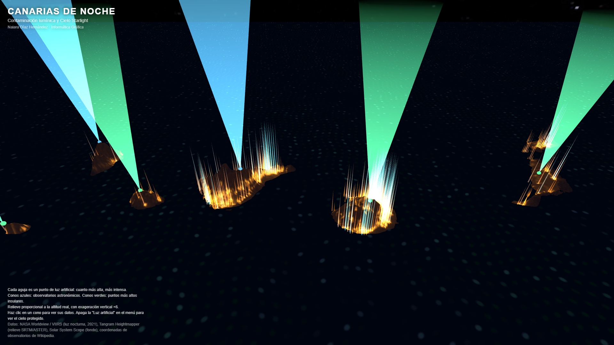
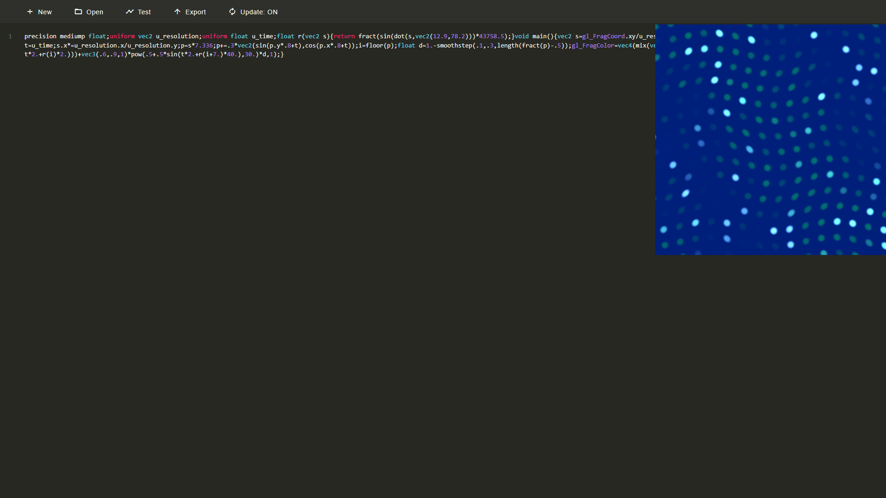
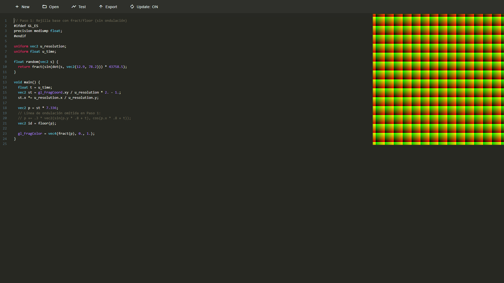
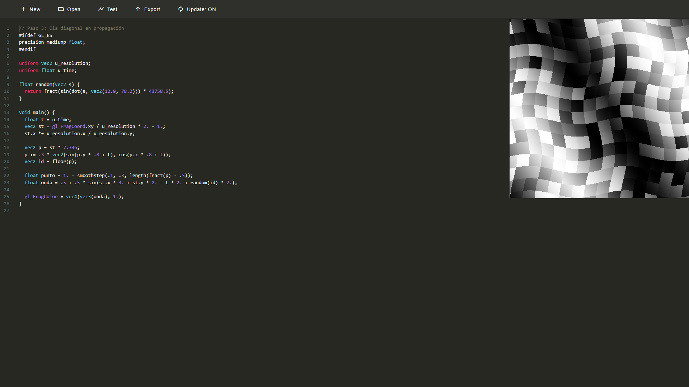

# Mar nocturno digital — Shaders GLSL

Shader de fragmentos hecho en GLSL, con olas en movimiento y destellos que imitan la bioluminiscencia. Incluye una versión *tiny code* de **510 bytes** para *The Book of Shaders*, la explicación paso a paso de cómo funciona y su integración como `ShaderMaterial` en la escena 3D de las Islas Canarias hecha con Three.js.

Práctica de la semana 9 de Informática Gráfica. Naiara Díaz Hernández, Universidad de Las Palmas de Gran Canaria.

  
*Vista general de la escena con el shader del mar y la luz artificial encendida*

Vídeos:

- **Shader tiny (510 bytes), reel vertical (1080×1920, 15 s):**  
  - Archivo local: [`videos/shader-reel.mp4`](videos/shader-reel.mp4)  
  - YouTube: [Enlace al vídeo del shader](URL_VIDEO_SHADER)
- **Demo interactiva de la escena Three.js (1920×1080, 60 s):**  
  - Archivo local: [`videos/demo-escena.mp4`](videos/demo-escena.mp4)  
  - YouTube: [Enlace al vídeo de la demo](URL_VIDEO_DEMO)

---

## Índice

1. [Motivación e idea visual](#motivación-e-idea-visual)
2. [El shader: versión tiny (510 bytes) y legible](#el-shader-versión-tiny-510-bytes-y-legible)
3. [Desarrollo técnico paso a paso](#desarrollo-técnico-paso-a-paso)
   - [1. Normalización de coordenadas y aspect ratio](#1-normalización-de-coordenadas-y-aspect-ratio)
   - [2. Rejilla celular con floor y fract](#2-rejilla-celular-con-floor-y-fract)
   - [3. Ondulación de la superficie con senos y cosenos](#3-ondulación-de-la-superficie-con-senos-y-cosenos)
   - [4. Puntos circulares suaves con smoothstep](#4-puntos-circulares-suaves-con-smoothstep)
   - [5. Ola diagonal en propagación y desfase aleatorio](#5-ola-diagonal-en-propagación-y-desfase-aleatorio)
   - [6. Destellos bioluminiscentes con potencia (pow)](#6-destellos-bioluminiscentes-con-potencia-pow)
   - [7. Composición cromática y mezcla de color](#7-composición-cromática-y-mezcla-de-color)
4. [Optimización hasta 510 bytes (≤ 512 bytes)](#optimización-hasta-510-bytes--512-bytes)
5. [Extra: Integración en la escena 3D de Canarias (S8)](#extra-integración-en-la-escena-3d-de-canarias-s8)
   - [ShaderMaterial y uniforms dinámicos](#shadermaterial-y-uniforms-dinámicos)
   - [Tabla comparativa: Editor vs. Escena Three.js](#tabla-comparativa-editor-vs-escena-threejs)
   - [Interacción con la Ley del Cielo](#interacción-con-la-ley-del-cielo)
6. [Limitaciones](#limitaciones)
7. [Cómo ejecutarlo](#cómo-ejecutarlo)
8. [Referencias](#referencias)

---

## Motivación e idea visual

En la práctica de la semana 8, el mar que rodea las islas era un plano quieto de un solo color oscuro. Cumplía su función, pero la escena nocturna quedaba sin vida justo en la parte que más ocupa la pantalla. Para esta práctica quise cambiarlo por algo que se moviera y que pegara con el tema, y me inspiré en la **bioluminiscencia del mar**.

En zonas de costa sin contaminación lumínica, cuando el agua se mueve, algunas microalgas sueltan pequeños destellos azules y blancos. Intenté llevar esa imagen a un shader: una malla de puntos de luz que ondula con el tiempo, con olas que cruzan en diagonal y chispas que se encienden y se apagan sin orden.

Además, el efecto encaja con el tema de la escena, la **Ley del Cielo** y la contaminación lumínica en Canarias. Con las luces de las ciudades apagadas, el mar queda oscuro y los destellos se ven mejor. Con la luz artificial encendida, el brillo de la costa tapa el agua y casi no se nota la bioluminiscencia.

[Volver al índice](#índice)

---

## El shader: versión tiny (510 bytes) y legible

El proyecto tiene dos versiones del mismo shader:

- [`shaders/mar_nocturno_tiny.frag`](shaders/mar_nocturno_tiny.frag): la versión reducida, de **510 bytes**, dentro del límite de 512 del reto *tiny code*.
- [`shaders/mar_nocturno_legible.frag`](shaders/mar_nocturno_legible.frag): la versión ordenada y con comentarios, para poder entender el código.

Este es el código de la versión tiny:

```glsl
precision mediump float;uniform vec2 u_resolution;uniform float u_time;float r(vec2 s){return fract(sin(dot(s,vec2(12.9,78.2)))*43758.5);}void main(){vec2 s=gl_FragCoord.xy/u_resolution*2.-1.,p,i;float t=u_time;s.x*=u_resolution.x/u_resolution.y;p=s*7.336;p+=.3*vec2(sin(p.y*.8+t),cos(p.x*.8+t));i=floor(p);float d=1.-smoothstep(.1,.3,length(fract(p)-.5));gl_FragColor=vec4(mix(vec3(0,.12,.48),vec3(0,.44,.44),d*(.5+.5*sin(s.x*3.+s.y*2.-t*2.+r(i)*2.)))+vec3(.6,.9,1)*pow(.5+.5*sin(t*2.+r(i+7.)*40.),30.)*d,1);}
```

Funciona tal cual en el editor de *The Book of Shaders*, que solo le pasa los uniforms `u_resolution` y `u_time`:

  
*El shader tiny (510 bytes) funcionando en el editor de The Book of Shaders*

No usa texturas ni datos externos. Todo el movimiento sale de las fórmulas y del tiempo:

  
*Tres momentos (t ≈ 0 s, 2 s y 4 s). Se ve cómo se deforma la rejilla y cómo se encienden los destellos en celdas distintas*

[Volver al índice](#índice)

---

## Desarrollo técnico paso a paso

Para hacerlo me apoyé en el guion de la asignatura y en los capítulos de formas, patrones y aleatoriedad de *The Book of Shaders*. Lo dividí en siete pasos.

### 1. Normalización de coordenadas y aspect ratio

Primero paso las coordenadas de píxel `gl_FragCoord.xy` a un sistema con el centro en el origen y valores entre -1 y 1. Después multiplico x por la relación de aspecto (ancho entre alto) para que las celdas no se estiren en pantallas anchas ni al cambiar el tamaño de la ventana:

```glsl
vec2 st = gl_FragCoord.xy / u_resolution * 2. - 1.;
st.x *= u_resolution.x / u_resolution.y;
```

### 2. Rejilla celular con floor y fract

Multiplico las coordenadas por una escala (7.336) y las separo con `floor` y `fract`:
- `floor(p)` da el número de cada celda, que uso como semilla para los valores aleatorios.
- `fract(p)` da la posición dentro de la celda, entre 0 y 1.

  
*Paso 1 en el editor: `fract(p)` pintado en los canales rojo y verde. Se ve cómo el plano queda dividido en celdas iguales*

### 3. Ondulación de la superficie con senos y cosenos

Una cuadrícula perfecta parece una pantalla de LEDs, no agua. Antes de separar las celdas, deformo las coordenadas sumando senos y cosenos cruzados que cambian con el tiempo:

```glsl
p += 0.3 * vec2(sin(p.y * 0.8 + t), cos(p.x * 0.8 + t));
```

Como el movimiento en x depende de y, y el de y depende de x, la rejilla se curva suavemente y recuerda al vaivén de una corriente.

### 4. Puntos circulares suaves con smoothstep

En cada celda calculo la distancia al centro con `length(fract(p) - 0.5)`. Si usara `step`, el borde saldría duro y con dientes de sierra, así que uso `smoothstep(0.1, 0.3, ...)` al revés, que da un centro brillante que se apaga poco a poco hacia el borde:

```glsl
float punto = 1. - smoothstep(0.1, 0.3, length(fract(p) - 0.5));
```

  
*Paso 2 en el editor: con la ondulación activada, `punto` pintado en escala de grises*

### 5. Ola diagonal en propagación y desfase aleatorio

Si todos los puntos brillaran igual a la vez, el efecto quedaría plano. Para evitarlo añado una onda que avanza en diagonal (3x + 2y - 2t) y le sumo un desfase distinto en cada celda, sacado de `random(id)`:

```glsl
float onda = 0.5 + 0.5 * sin(st.x * 3. + st.y * 2. - t * 2. + random(id) * 2.);
```

La función `random` es la clásica de *The Book of Shaders* [Gon21, capítulo 10], que usa un producto escalar y la parte decimal de un seno. Las constantes originales son 12.9898, 78.233 y 43758.5453123; en mi versión las recorté a 12.9, 78.2 y 43758.5 para ahorrar bytes en el *tiny code*:

```glsl
float random(vec2 s) {
  return fract(sin(dot(s, vec2(12.9, 78.2))) * 43758.5);
}
```

  
*Paso 3 en el editor: la variable `onda` en grises, con el degradado en diagonal y las diferencias entre celdas*

### 6. Destellos bioluminiscentes con potencia (pow)

La bioluminiscencia real funciona así: casi no se ve durante mucho rato y de repente salta una chispa corta. Para imitarlo elevo una señal con seno a una potencia alta (30):

```glsl
float chispa = pow(0.5 + 0.5 * sin(t * 2. + random(id + 7.) * 40.), 30.);
```

La base `0.5 + 0.5 * sin(...)` va suave entre 0 y 1. Al elevarla a 30, se queda muy cerca de 0 casi todo el ciclo. Por ejemplo, solo pasa de 0.05 durante un 20 % del tiempo y solo pasa de 0.5 durante un 10 %. Así cada celda se enciende en un pico corto. Como cada celda usa una semilla distinta (`id + 7.`) y se multiplica por 40, los parpadeos no coinciden entre celdas.

  
*Paso 4 en el editor: el término `chispa * punto`, donde solo brillan las celdas que están en su pico*

### 7. Composición cromática y mezcla de color

Para el color uso tres tonos:
- **Azul oscuro:** `vec3(0.0, 0.12, 0.48)`, el fondo del agua.
- **Turquesa:** `vec3(0.0, 0.44, 0.44)`, las olas.
- **Blanco azulado:** `vec3(0.6, 0.9, 1.0)`, las chispas más fuertes.

Con `mix()` mezclo el azul y el turquesa según la intensidad de la ola, y después sumo el destello en el centro de cada punto:

```glsl
vec3 color = mix(oscuro, claro, punto * onda);
color += brillo * chispa * punto;
gl_FragColor = vec4(color, 1.);
```

[Volver al índice](#índice)

---

## Optimización hasta 510 bytes (≤ 512 bytes)

El enunciado valora el *tiny code* de hasta 512 bytes, contando los uniforms. La versión legible tiene más de 1.500 caracteres, así que la fui acortando sin cambiar el resultado. Estas fueron las técnicas:

1. **Declarar juntas las variables del mismo tipo:** `vec2 s=...,p,i;` en una sola línea en vez de tres.
2. **Quitar el cero antes del punto:** `.3`, `.8`, `.1`, `.44`, etc.
3. **Enteros dentro de constructores:** en `vec3(0,.12,.48)` o `vec3(.6,.9,1)` el constructor convierte los enteros a decimales, así que me ahorro el punto. Solo lo hago dentro de constructores. En el resto del código sigo escribiendo los decimales con punto, como recomienda el guion, para evitar errores según la tarjeta gráfica.
4. **Nombres de una letra:** `random` pasa a `r`, las coordenadas normalizadas a `s`, la posición a `p`, el número de celda a `i` y el punto a `d`.
5. **Escribir las operaciones directamente dentro de `gl_FragColor`:** desaparecen las variables `onda`, `chispa`, `oscuro`, `claro` y `color`.
6. **Quitar espacios y saltos de línea,** salvo los que separan palabras (`float`, `vec2`, `return`, `void`).
7. **Mantener los nombres estándar `u_resolution` y `u_time`** para que funcione en cualquier editor GLSL sin cambios.
8. **Quitar las líneas `#ifdef GL_ES` y `#endif`** que rodean a `precision mediump float;` en la versión legible. Esas líneas solo comprueban si se está usando GL_ES (móviles y navegadores), y en el editor de *The Book of Shaders* siempre es así, por lo que la línea de precisión se aplica igual y me ahorro esas dos líneas.
9. **Recortar las constantes de `random`** (de 12.9898, 78.233 y 43758.5453123 a 12.9, 78.2 y 43758.5) sin que cambie el aspecto del patrón.

El archivo [`shaders/mar_nocturno_tiny.frag`](shaders/mar_nocturno_tiny.frag) ocupa **510 bytes** en disco, comprobado desde la consola:

  
*Comprobación del tamaño: 510 bytes, por debajo del límite de 512*

[Volver al índice](#índice)

---

## Extra: Integración en la escena 3D de Canarias (S8)

Como extra, metí el shader en la visualización 3D de las Islas Canarias que hice en la práctica anterior con Three.js. En esa escena el relieve se construye moviendo vértices según modelos de elevación, y las luces de las ciudades salen de texturas del sensor VIIRS (NASA Black Marble). Los conos de luz marcan los observatorios del Teide y del Roque de los Muchachos.

### ShaderMaterial y uniforms dinámicos

Para cambiar el mar quieto creé un `THREE.ShaderMaterial` y se lo puse a un plano grande (40 × 40 unidades) a la altura del mar (z = 0.005).

El shader de vértices le pasa la posición del plano al de fragmentos con un varying:

```glsl
varying vec2 vP;
void main() {
  vP = position.xy;
  gl_Position = projectionMatrix * modelViewMatrix * vec4(position, 1.0);
}
```

El shader de fragmentos de la escena declara, además de lo que ya está en el editor, el varying y los uniforms propios de la integración:

```glsl
varying vec2 vP;
uniform float u_time;
uniform float u_luz;
```

En cada fotograma, el bucle de render actualiza el tiempo:

```js
matMar.uniforms.u_time.value = performance.now() / 1000;
```

### Tabla comparativa: Editor vs. Escena Three.js

Al pasar el código del editor a la escena 3D tuve que cambiar algunas cosas:

| Concepto | Editor (*The Book of Shaders*) | Escena 3D (*Three.js*) |
|---|---|---|
| **Sistema de coordenadas** | Píxeles de pantalla (`gl_FragCoord.xy`) | Coordenadas propias del plano (`varying vec2 vP`) |
| **Corrección de aspecto** | Necesaria: `st.x *= u_resolution.x / u_resolution.y` | No hace falta: el plano ya tiene las mismas unidades en x e y |
| **Escala de repetición** | Fija, 7.336 sobre la ventana | s = vP · 0.45 y p = s · 15.0 (unas 6.75 celdas por unidad) |
| **Uniform de tiempo** | Lo da el editor (`u_time`) | Se actualiza desde JS con `performance.now() / 1000` |
| **Interacción con la luz** | Ninguna, el shader va solo | Uniform `u_luz`, conectado al control de contaminación lumínica |

### Interacción con la Ley del Cielo

El uniform `u_luz` va de 1.0 (luz de la ciudad encendida) a 0.0 (cielo protegido), con un cambio gradual cuando se activa la casilla del panel de control:

```js
if (matMar) matMar.uniforms.u_luz.value = luzNivel;
```

En el shader, `u_luz` cambia tanto el brillo del agua como la fuerza de los destellos:

```glsl
// Fondo del mar: se oscurece al apagar las luces artificiales
vec3 c = mix(oscuro, claro, d * onda) * mix(0.04, 0.12, u_luz);

// Destellos: se duplican en la oscuridad (de 0.12 a 0.25)
c += brillo * chispa * d * mix(0.25, 0.12, u_luz);
```

  
*A la izquierda, el resplandor de las ciudades aclara el mar. A la derecha, con el cielo protegido, el agua queda más oscura y los destellos se ven más*

La diferencia se ve mejor al acercar la cámara a la costa:

  
*Vista a ras del mar con la luz artificial encendida (`teleportCamera(0.5, -2.5, 0.35, 0.5, 0, 0.1)`)*

  
*Misma posición con la luz artificial apagada: más contraste entre los puntos del agua y destellos más claros*

[Volver al índice](#índice)

---

## Limitaciones

- **Precisión en móviles:** la función `random`, que usa `fract(sin(...) * 43758.5)`, depende de la precisión de la GPU. En móviles o tarjetas con poca precisión pueden aparecer patrones repetidos que no deberían estar.
- **Repetición a gran escala:** como se basa en senos y no en ruido Perlin o Simplex, desde muy lejos se pueden ver bandas regulares.
- **Sin niebla de Three.js:** el mar usa un `ShaderMaterial` propio que no incluye el trozo `fog_fragment`, así que el control de densidad de niebla no afecta al horizonte del agua.
- **Versión tiny difícil de leer:** al quitar espacios y usar nombres de una letra, `shaders/mar_nocturno_tiny.frag` es muy incómodo de depurar. Para cualquier cambio hay que trabajar sobre `shaders/mar_nocturno_legible.frag`.

[Volver al índice](#índice)

---

## Cómo ejecutarlo

### En el editor web de The Book of Shaders
No hace falta instalar nada:
1. Abrir el editor: [http://editor.thebookofshaders.com](http://editor.thebookofshaders.com).
2. Borrar el código inicial y pegar el contenido de [`shaders/mar_nocturno_tiny.frag`](shaders/mar_nocturno_tiny.frag) (o de [`shaders/mar_nocturno_legible.frag`](shaders/mar_nocturno_legible.frag)).
3. El editor lo compila y lo ejecuta solo.

### Escena 3D completa (Three.js)

#### En CodeSandbox
Se puede ver la escena completa, con relieve, luces nocturnas y el shader del mar, directamente en el navegador:
- **Sandbox:** [https://codesandbox.io/p/devbox/practica-s8-forked-xwlynk?workspaceId=ws_DCHKvkQUtznGkewsQK8dw](https://codesandbox.io/p/devbox/practica-s8-forked-xwlynk?workspaceId=ws_DCHKvkQUtznGkewsQK8dw)

#### En local (Node.js)
Clonar o descargar el repositorio y ejecutar en la raíz:

```bash
npm install
npm run dev
```

El servidor local suele arrancar en [http://localhost:5173/](http://localhost:5173/).

Archivos principales:
- `shaders/mar_nocturno_tiny.frag`: shader reducido de 510 bytes.
- `shaders/mar_nocturno_legible.frag`: shader con comentarios.
- `images/`: capturas y composiciones de la práctica.
- `videos/`: grabaciones MP4 a 30 fps sin audio (`shader-reel.mp4` y `demo-escena.mp4`).

[Volver al índice](#índice)

---

## Referencias

- [Guion de la semana 9 de Informática Gráfica](https://github.com/otsedom/otsedom.github.io/tree/main/IG/S9): fragment shaders en GLSL, patrones generativos y tiny coding.
- [Guion de la semana 8 de Informática Gráfica](https://github.com/otsedom/otsedom.github.io/tree/main/IG/S8): modelos de elevación y visualización 3D en Three.js.
- [Gon21] [The Book of Shaders](https://thebookofshaders.com) (Patricio Gonzalez Vivo y Jen Lowe):
  - [Capítulo 05: Colores](https://thebookofshaders.com/05/?lan=es)
  - [Capítulo 09: Patrones](https://thebookofshaders.com/09/?lan=es)
  - [Capítulo 10: Aleatoriedad](https://thebookofshaders.com/10/?lan=es)
- [Editor interactivo de The Book of Shaders](http://editor.thebookofshaders.com)
- [Documentación de Three.js: ShaderMaterial](https://threejs.org/docs/#api/en/materials/ShaderMaterial)
- [Khronos Group: The OpenGL ES Shading Language (GLSL ES 1.00 / 3.00)](https://www.khronos.org/registry/OpenGL/specs/es/)
- [NASA Earth Observatory / Black Marble: VIIRS Nighttime Lights](https://earthobservatory.nasa.gov/features/NightLights)

***
Grado en Ingeniería Informática  
Naiara Díaz Hernández — Informática Gráfica
